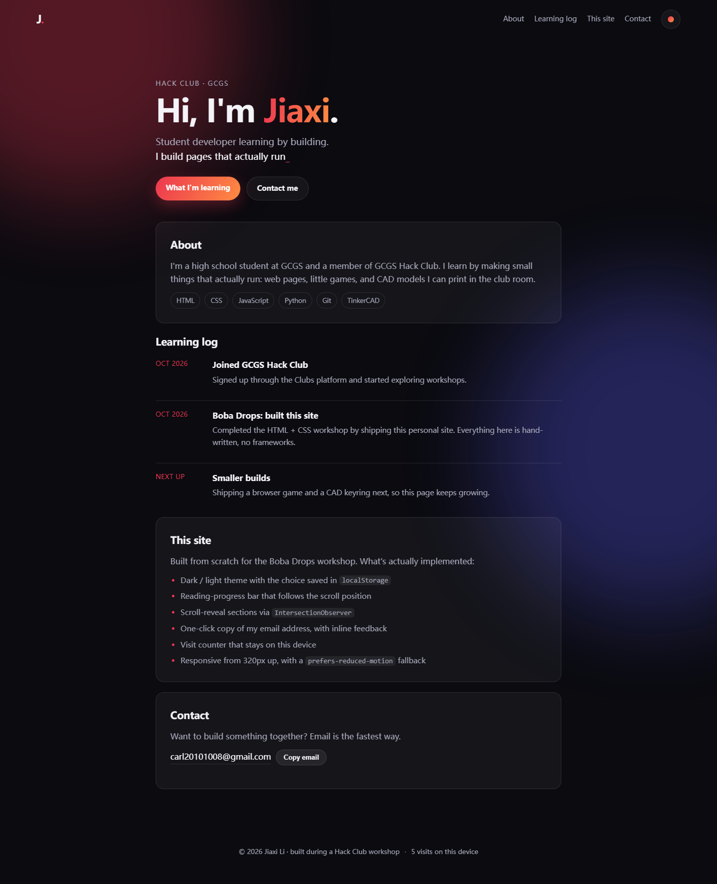

# Boba Drops — personal site

A single-page personal site written from scratch for the **Boba Drops** Hack Club
workshop: plain HTML, CSS and a small amount of vanilla JavaScript. No frameworks,
no build step, no dependencies — three files plus a favicon.



## Live demo & code

| | Link |
| --- | --- |
| Live demo | `https://<your-site-here>/` ← replace after deploying |
| Code | `https://github.com/<your-username>/<your-repo>` ← replace after pushing |

Both links are required when you submit `Apply to run` for the workshop.

## Run it locally

```bash
# any static server works; this repo includes a tiny one
node server.js 8123 .
# open http://127.0.0.1:8123
```

Or simply open `index.html` in a browser — there is no build step.

## What's inside

| File | Purpose |
| --- | --- |
| `index.html` | Structure: hero, about, learning log, site notes, contact |
| `styles.css` | Design tokens, dark/light themes, layout, animation, responsive rules |
| `script.js` | Typewriter, scroll reveal, progress bar, theme toggle, copy email, visit counter |
| `favicon.svg` | Hand-written SVG icon |
| `screenshot.png` | Full-page screenshot used in this README and in `og:image` |

## Features

- **Dark / light theme**, choice saved in `localStorage`; applied before first paint
  by a tiny inline script so there is no flash of the wrong theme.
- **Reading-progress bar** pinned to the top of the viewport.
- **Scroll-reveal** sections using `IntersectionObserver` (degrades to visible when
  the API is unavailable).
- **Copy email** button with an async-clipboard path and a `execCommand` fallback
  for browsers or contexts where the clipboard API is blocked.
- **Visit counter** stored per device — no backend, no tracking, no cookies.
- **Responsive from 320px** with a `prefers-reduced-motion` fallback that disables
  the typewriter, reveal and smooth scrolling.
- **Accessible**: skip link, one `h1`, landmark sections, keyboard-visible focus
  rings, `aria-pressed` on the theme toggle, `role="status"` for copy feedback.

## Quality checks (measured)

Run against a local server with a headless Chrome driver (see the table below for
the values observed on the last run). Every item is a pass:

| Check | Result |
| --- | --- |
| `<h1>` count | 1 |
| `href="#"` dead links | 0 |
| Internal anchors that resolve | all (0 broken) |
| CSS / JS loaded | yes / yes |
| `favicon.svg` | HTTP 200, `image/svg+xml` |
| Theme toggle | dark → light, `aria-pressed` follows |
| Copy email | "Copied: carl20101008@gmail.com" |
| Scroll progress at bottom | 100% at max scroll |
| Horizontal overflow at 390px | none (scrollWidth = 390) |
| Console errors / uncaught exceptions | 0 / 0 |

## Deploy

Pick one — both are free and take under a minute once set up.

### Netlify Drop (fastest)

1. Open <https://app.netlify.com/drop>
2. Drag the whole project folder (the one containing `index.html`) into the page
3. Copy the `*.netlify.app` URL → that is your **demo URL**

### GitHub Pages (permanent, also gives you the code URL)

```bash
git init
git add index.html styles.css script.js favicon.svg screenshot.png README.md
git commit -m "Boba Drops personal site"
git branch -M main
git remote add origin https://github.com/<your-username>/<your-repo>.git
git push -u origin main
```

Then: repository **Settings → Pages → Source: Deploy from a branch → `main` / `/ (root)`**.
After a minute the demo URL is `https://<your-username>.github.io/<your-repo>/`,
and the code URL is the repository page.

## Submitting to the workshop

1. `Workshops → Boba Drops → Apply to run`
2. Fill **Demo URL** (the live site) and **Code URL** (the repository)
3. Submit for review — reviewers take about 1–3 weekdays

## Editing guide

Everything you normally want to change is text in `index.html`:

- Name and tagline: the `<h1>`, `.lede` and the `phrases` array in `script.js`
- About paragraph and skill chips: `#about`
- Learning-log entries: `#log` (keep them factual — reviewers read this page)
- Contact email: `#contact` and the `EMAIL` constant in `script.js`
- Colours: the `:root` variables at the top of `styles.css`

## License

MIT — do whatever you like with the code. Replace the personal content with your own.
